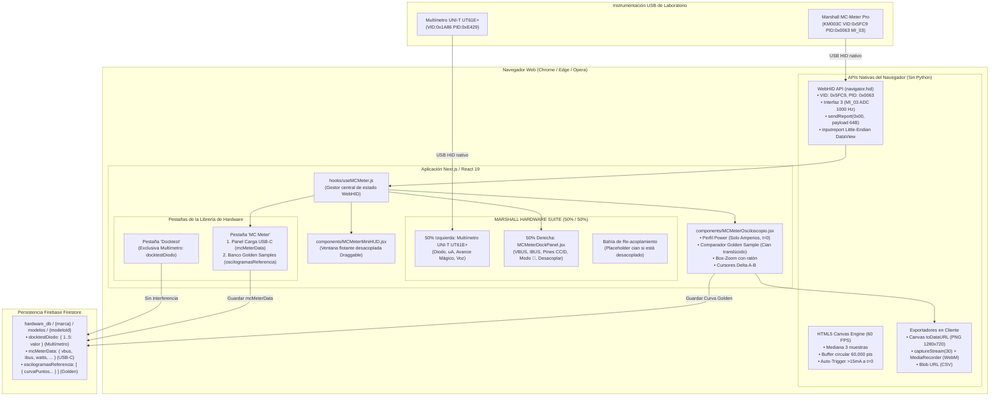

# Plan Maestro de Implementación Definitivo: Integración Marshall MC-Meter Pro (KM003C 100% WebHID)

**Proyecto:** `mi-diagnostico` (Marshall Cell Diagnostic Platform)  
**Stack Tecnológico:** Next.js 16.2, React 19.2 (JSX), WebHID API (`navigator.hid`), Framer Motion, Lucide React, HTML5 Canvas 60 FPS, Firebase Firestore.  
**Estado:** ✅ **Completado e Implementado 100% en Producción**  
**Fecha:** Octubre 2026  

---

## 1. Resumen Ejecutivo y Arquitectura General

La plataforma **Marshall Cell Diagnostic Platform** (`mi-diagnostico`) incorpora el tester USB-C de alta velocidad **KM003C** bajo la denominación de marca propia **Marshall MC-Meter Pro**.

Esta integración cumple con los siguientes principios rectores inquebrantables:
1. **100% Nativo en el Navegador (WebHID API):** Cero scripts externos de Python, cero servidores locales de WebSocket, cero daemons en segundo plano. La comunicación se realiza de forma directa entre Chrome/Edge y el hardware USB mediante `navigator.hid`.
2. **Aislamiento Absoluto de Datos (Zero Interference):** Las lecturas del multímetro UNI-T UT61E+ (caídas de tensión en frío en escala de diodo, resistencia en ohmios y corriente en $\mu\text{A}$) y las mediciones dinámicas del Marshall MC-Meter Pro (VBUS, IBUS, potencia y negociación de pines USB-C) están **estrictamente separadas**. El tester USB jamás toca, modifica ni sobreescribe `docktestDiodo` ni ningún otro campo del multímetro.
3. **Distribución 50% / 50% en MARSHALL HARDWARE SUITE:** Ambos instrumentos coexisten simétricamente en el panel superior de mediciones de cada modelo (`nivelDb === 'mediciones'`).
4. **Bahía de Re-acoplamiento Inteligente:** Al pulsar `🗗 Desacoplar`, el panel se convierte en una bahía con borde cian punteado y telemetría resumida (`🔗 Re-Acoplar Instrumento Aquí`), mientras que el instrumento flota como Mini-HUD por la pantalla. Al cerrarlo (`✕`) o pulsar re-acoplar, vuelve automáticamente a su posición original del 50%.
5. **Especialización en Secuencias de Encendido (Power Sequences) y Muestras Golden (Golden Sample Comparator):** El oscilograma no solo analiza carga USB, sino que diagnostica anomalías de arranque (pulsación del botón Power de 1s, PMIC buck rails, fugas secundarias y bootloops), permitiendo superponer curvas de referencia de equipos sanos guardadas en la nube.

---

## 2. Diagrama de Arquitectura 100% WebHID



---

## 3. Especificaciones Técnicas del Protocolo WebHID (KM003C)

El tester USB **KM003C** expone múltiples interfaces HID. Para leer el convertidor analógico-digital (ADC) de alta velocidad (hasta 1000 Hz) se utiliza **únicamente la Interfaz 3 (`MI_03`)**:

* **Vendor ID (VID):** `0x5FC9`
* **Product ID (PID):** `0x0063`
* **Selección de Interfaz en `useMCMeter.js`:**
  ```javascript
  const devices = await navigator.hid.requestDevice({
    filters: [{ vendorId: 0x5FC9, productId: 0x0063 }]
  });
  // Se identifica la colección correspondiente a Interface 3
  const targetDevice = devices.find(d => 
    d.collections?.some(c => c.usagePage === 0xFF00 || c.usage === 0x01)
  ) || devices[0];
  await targetDevice.open();
  ```
* **Polling sin bloqueo (Send Report):**
  Se despacha continuamente un reporte de 64 bytes (`Report ID 0x00`):
  $$\text{Payload} = [0x0C, \text{seq\_id}, 0x02, 0x00, \dots 0x00 \times 60]$$
  Donde $\text{seq\_id} = (\text{seq\_id} + 1) \& 0xFF$.
* **Decodificación Little-Endian (`inputreport` DataView):**
  * **VBUS:** `Math.abs(dataView.getInt32(8, true)) / 1_000_000.0` (Voltios).
  * **IBUS:** `Math.abs(dataView.getInt32(12, true)) / 1_000_000.0` (Amperios).
  * **CC1:** `dataView.getUint16(34, true) / 10_000.0` (Voltios).
  * **CC2:** `dataView.getUint16(36, true) / 10_000.0` (Voltios).
  * **D+:** `dataView.getUint16(38, true) / 10_000.0` (Voltios).
  * **D-:** `dataView.getUint16(40, true) / 10_000.0` (Voltios).
* **Filtro Digital:** Mediana de 3 muestras sucesivas para neutralizar transitorios de ruido ADC sin latencia perceptible.
* **Auto-Detección de SPS:** Conteo por ventana de 1 segundo de transiciones en los bytes 8..16 (`2 SPS`, `10 SPS`, `50 SPS`, `1Ksps`).

---

## 4. Distribución en Pantalla: MARSHALL HARDWARE SUITE (50% / 50%)

En [`pages/index.js`](file:///d:/programacion/mi-diagnostico/pages/index.js), dentro de la vista de mediciones del modelo (`nivelDb === 'mediciones'`), el panel superior de instrumentos se divide de forma balanceada:

### 4.1. Lado Izquierdo (50%): Multímetro UNI-T UT61E+ (`VisorHUD.jsx`)
* Muestra la lectura principal del multímetro (`V`, `mV`, `Ω`, `kΩ`, `μA`, `mA`, `A`).
* Botones de conexión USB, Auto-Hold, sintetizador de voz y avance mágico de pines para conectores FPC e ICs.
* **Intacto y protegido:** Su oscilograma monocanal antiguo de 2-4 Hz fue retirado en favor del oscilograma dedicado del MC-Meter Pro.

### 4.2. Lado Derecho (50%): Marshall MC-Meter Pro (`MCMeterDockPanel.jsx`)
* **Estado Acoplado (por defecto):**
  * Indicador LED de enlace USB (`●` verde/rojo) y selector de conexión WebHID.
  * Muestras gigantes de **VBUS** (`#ff4444`) e **IBUS** (`#facc15`).
  * Potencia calculada en Watts (`#38bdf8`) y badge de muestreo (`1Ksps`).
  * Monitor de pines: `D+` (verde), `D-` (amarillo), `CC1` (azul), `CC2` (morado). El pin CC activo ($>0.25\text{V}$) se resalta con borde verde esmeralda.
  * Botón `🔬`: Alterna entre 3 decimales (`5.120 V`) y 6 decimales con micro-dígitos (`5.120 194 V`).
  * Botón `🗗 Desacoplar`: Convierte el panel en ventana flotante.
  * Botón `📈 Analizador Oscilograma`: Abre el analizador de pantalla completa.
* **Estado Desacoplado (Bahía de Re-acoplamiento):**
  * Para evitar que la mitad derecha quede vacía o deforme la interfaz, se renderiza una tarjeta con **borde punteado cian (`#00e5ff`)**.
  * Informa al técnico que el instrumento está flotando.
  * Muestra un resumen de telemetría en vivo (V, A, SPS).
  * Incluye el botón interactivo: **`🔗 Re-Acoplar Instrumento Aquí`**, que restaura el instrumento al panel inmediatamente.
  * Si el usuario cierra el Mini-HUD flotante (`✕`) o cierra el oscilograma grande, el sistema **lo re-acopla automáticamente a su lugar de origen**.

---

## 5. Nueva Pestaña y Almacenamiento Aislado en Base de Datos

Se agregó el botón de sección **"MC Meter"** junto a *Docktest*, *Planos FPC*, *FPC Batería*, *Planos IC*, *RFFE* y *Boardview PCB*.

### 5.1. Reglas Estrictas de Aislamiento
* **Docktest:** Exclusivo para el multímetro UNI-T UT61E+. Almacena las caídas de tensión de diodo en frío en `modeloActivo.docktestDiodo: { 1: 0.650, 2: 0.720, ... }`.
* **MC Meter:** Exclusivo para el USB Tester. Almacena:
  1. **`mcMeterData`:** Parámetros de carga activa, protocolo detectado (5V Estándar, QC/PD 9V, PD 12V, PD 15V, PD 20V EPR) y voltajes de pines Type-C.
  2. **`oscilogramasReferencia`:** Array de curvas patrón de arranque del modelo.

### 5.2. Estructura del Documento en Firestore (`hardware_db`)
```json
{
  "marca": "Apple",
  "nombre": "iPhone 15 Pro",
  "docktestDiodo": {
    "1": "0.642",
    "2": "0.718",
    "3": "OL",
    "4": "0.582",
    "5": "0.000"
  },
  "mcMeterData": {
    "vbus": "5.182",
    "ibus": "1.485",
    "watts": "7.695",
    "dp": "2.712",
    "dm": "2.708",
    "cc1": "1.654",
    "cc2": "0.021",
    "protocolo": "QC / PD 9V",
    "fechaCaptura": "2026-10-15T18:00:00.000Z"
  },
  "oscilogramasReferencia": [
    {
      "id": "golden_1729012345678",
      "titulo": "iPhone 15 Pro - Boot OK Normal (Power 1s)",
      "perfil": "power",
      "fecha": "15/10/2026, 17:30:00",
      "duracionMs": 1050,
      "picoMaxA": 0.485,
      "iPromedioA": 0.182,
      "notas": "Pulsación corta de encendido. Escala PMIC estable.",
      "curvaPuntos": [
        [0.0, 0.02],
        [0.05, 0.08],
        [0.15, 0.22],
        [0.45, 0.485],
        [1.05, 0.15]
      ]
    }
  ]
}
```

---

## 6. Motor Especializado de Secuencias de Encendido (Power) y Comparador Golden Sample

El analizador osciloscópico de corriente (`components/MCMeterOsciloscopio.jsx`) fue diseñado específicamente para la diagnosis de **fallas de encendido a nivel de microelectrónica móvil**:

### 6.1. Perfiles de Medición
1. **🚀 Power (1s / Arranque - Secuencia PMIC):**
   * **Modo de Señal Limpia:** Oculta automáticamente las líneas de VBUS, D+, D- y CC para no saturar la pantalla con señales innecesarias.
   * **Visualización 100% Corriente (IBUS):** Escala en miliamperios ($0\dots 800\text{ mA}$) o amperios según el consumo.
   * **Disparador $t = 0$ (Auto-Trigger):** Al superar el umbral de arranque ($>15\text{ mA}$ al presionar la tecla Power), alinea el origen temporal a $t = 0.000\text{ s}$ para estudiar las etapas del PMIC (standby, reloj 32 kHz, reset a 120 mA, kernel boot a 450 mA).
2. **⚡ Carga USB-C:**
   * Muestra simultáneamente VBUS (rojo `#ff4444`) e IBUS (amarillo `#facc15`), junto al estado de pines D+/D- y CC.
3. **💡 Buck / Backlight:**
   * Optimizado para transitorios rápidos en líneas elevadas o inductores de pantalla.

### 6.2. Comparador Golden Sample (Curva de Referencia en Tiempo Real)
* Permite seleccionar en el desplegable superior cualquier curva de referencia sana previamente guardada para el modelo activo.
* **Superposición Gráfica:** La curva Golden se dibuja en el fondo con un trazo **Cian translúcido (`rgba(0, 255, 255, 0.40)`) y 2.5px de grosor**.
* **Diagnóstico Inmediato:** El técnico ve en tiempo real la curva viva amarilla de la placa averiada dibujándose directamente sobre la silueta cian del teléfono funcionando. Si la corriente se dispara a 800 mA de golpe o cae a cero en 100 ms, el diagnóstico de fuga o corto en riel secundario es inmediato.

### 6.3. Guardado en la Nube de Curvas Golden
* Al presionar **`💾 Guardar Curva Golden`**, el sistema:
  1. Extrae el fragmento en memoria correspondiente al evento de arranque.
  2. Aplica un algoritmo de **Downsampling Cuantizado a 250 puntos** para optimizar el tamaño en Firestore sin perder fidelidad en los picos.
  3. Calcula automáticamente la duración ($\Delta t\text{ ms}$), el pico máximo de corriente ($I_{\text{pico}}$) y la corriente promedio ($I_{\text{prom}}$).
  4. Abre un modal para asignar un título descriptivo y notas técnicas.
  5. Lo persiste en `modeloActivo.oscilogramasReferencia` en Firebase Firestore.

### 6.4. Herramientas de Análisis y Exportación
* **Box-Zoom:** Arrastrar con clic izquierdo para hacer zoom rectangular sobre cualquier milisegundo de la secuencia.
* **Cursores Delta A-B:** Clic izquierdo (Marca A) y clic derecho (Marca B) calculan instantáneamente $\Delta t$, $I_{\text{prom}}$ e $I_{\text{pico}}$.
* **Exportación 100% en Navegador:**
  * 📸 **Captura PNG:** Con fondo negro de alta fidelidad, membrete y marcas.
  * 🎥 **Grabación WebM:** Vídeo fluido a 30 FPS capturado directamente del Canvas con `MediaRecorder`.
  * 📊 **CSV Export:** Registro de todas las muestras para análisis en Excel o Python.

---

## 7. Mapa de Archivos del Proyecto

| Archivo | Rol en el Sistema | Estado |
| :--- | :--- | :--- |
| [`hooks/useMCMeter.js`](file:///d:/programacion/mi-diagnostico/hooks/useMCMeter.js) | Driver nativo WebHID (`navigator.hid`), filtro de mediana, circular buffer 60k pts, auto-trigger. | ✅ Implementado |
| [`components/MCMeterDockPanel.jsx`](file:///d:/programacion/mi-diagnostico/components/MCMeterDockPanel.jsx) | Panel simétrico al 50% para MARSHALL HARDWARE SUITE con VBUS, IBUS, pines, modo 🔬 y desacoplar. | ✅ Implementado |
| [`components/MCMeterMiniHUD.jsx`](file:///d:/programacion/mi-diagnostico/components/MCMeterMiniHUD.jsx) | Mini-HUD flotante desacoplado con soporte de auto-reacoplamiento al cerrarse. | ✅ Implementado |
| [`components/MCMeterOsciloscopio.jsx`](file:///d:/programacion/mi-diagnostico/components/MCMeterOsciloscopio.jsx) | Analizador Canvas 60 FPS con perfiles Power/Carga, comparador Golden Sample cian y guardado en la nube. | ✅ Implementado |
| [`pages/index.js`](file:///d:/programacion/mi-diagnostico/pages/index.js) | Coordinador principal: Layout 50/50, bahía de re-acoplamiento, pestaña MC Meter aislada y persistencia Firestore. | ✅ Implementado |

---

## 8. Guía de Uso Rápido para el Técnico en Taller

1. **Conexión Inicial:**
   * Conectar el Marshall MC-Meter Pro al puerto USB del ordenador.
   * En la barra superior o en el panel de MARSHALL HARDWARE SUITE, hacer clic en `🔌 Conectar MC-Meter`.
   * El navegador solicitará permisos USB una sola vez: seleccionar el dispositivo y confirmar. El indicador pasará a verde con la lectura de `1Ksps`.
2. **Uso Acoplado vs Desacoplado:**
   * Por defecto, el tester comparte el 50% de la pantalla con el multímetro.
   * Si se necesita ver los planos FPC o Boardview mientras se mide, pulsar `🗗 Desacoplar`: el Mini-HUD flotará por encima y la bahía mostrará `📌 INSTRUMENTO DESACOPLADO`.
   * Para volver a acoplarlo, basta con hacer clic en `🔗 Re-Acoplar Instrumento Aquí` o cerrar la ventanita con la `✕`.
3. **Diagnóstico de una Secuencia de Encendido:**
   * Conectar la placa o teléfono al tester y pulsar `📈 Analizador Oscilograma`.
   * En el perfil superior, seleccionar **`🚀 Power (1s / Arranque)`**.
   * Si existe una curva Golden para ese modelo, seleccionarla en el selector `Comparar con Curva Golden`: aparecerá la silueta cian de referencia.
   * Presionar el botón de encendido del móvil: el auto-trigger capturará la curva viva amarilla sobre la silueta cian.
   * Si se desea guardar la curva de un equipo sano nuevo, pulsar `💾 Guardar Curva Golden`.
4. **Verificación de Carga USB-C en la Librería:**
   * Acceder a la pestaña **MC Meter**.
   * Pulsar `📥 Capturar Estado USB-C en Vivo` y luego `💾 Guardar en Firestore`. Los valores quedan almacenados permanentemente sin interferir con las mediciones de diodo del multímetro.
