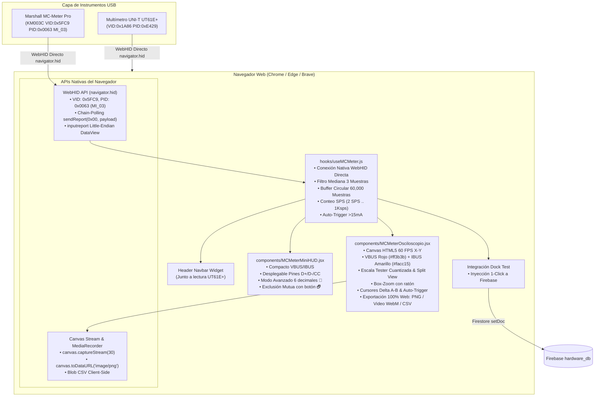

# Plan de Implementación Integral: Integración Marshall MC-Meter Pro (KM003C USB HID)
**Proyecto:** `mi-diagnostico` (Marshall Cell Diagnostic Platform)  
**Stack Tecnológico:** Next.js 16.2, React 19.2 (JSX), Framer Motion, Lucide React, HTML5 Canvas, Firebase Firestore, Python (hidapi, asyncio, websockets).  
**Autor:** Senior Hardware USB HID & Frontend Architect  
**Fecha:** Octubre 2026  

---

## 1. Resumen Ejecutivo y Objetivos

El objetivo de esta integración es incorporar el tester USB **KM003C** (denominado en la aplicación **Marshall MC-Meter Pro** para fines de marca propia) dentro de la plataforma web de diagnóstico técnico `mi-diagnostico`. 

Esta integración sustituye la función previa del oscilograma monocanal del multímetro UNI-T UT61E+ (limitado por hardware a 2–4 Hz) por un **Analizador Oscilograma X-Y de Alta Resolución y 1000 Hz (1 Ksps)** con capacidad de análisis de consumo dual (VBUS + IBUS), detección de protocolos en pines USB-C (D+, D-, CC1, CC2), inspección mediante Box-Zoom, cursores Delta A-B, grabación de video, y captura instantánea directa hacia la base de datos de **Dock Test** en Firebase Firestore.

> [!IMPORTANT]
> **Integridad de Funciones Existentes:** Todas las funcionalidades operativas del multímetro UNI-T UT61E+ (medición de diodo en FPC e IC, escala de $\mu\text{A}$, ohmios, voltios, auto-hold con avance mágico de pin y síntesis de voz) **se mantienen 100% intactas**. Solo se desacopla y reemplaza la visualización del oscilograma.

---

## 2. Especificaciones Técnicas del Protocolo USB HID (KM003C)

El dispositivo es un instrumento USB HID compuesto. No se debe inventar ni alterar la parametrización decodificada:

* **Identificadores USB:**
  * **VID (Vendor ID):** `0x5FC9`
  * **PID (Product ID):** `0x0063`
  * **Interfaz de Comunicación ADC:** `Interface = 3` (`MI_03`)
* **Comando de Solicitud de Muestras (Polling):**
  * Longitud: 65 bytes (1 byte Report ID `0x00` + 64 bytes payload).
  * Estructura del Payload: `[0x00, 0x0C, seq_id, 0x02, 0x00] + [0x00] * 60`
  * `seq_id`: Contador incremental de 8 bits (`0` a `255`, con desbordamiento `(seq_id + 1) & 0xFF`).
  * Frecuencia de envío: Bucle continuo sin bloqueo con `timeout_ms = 12` (~1000 consultas por segundo).
* **Decodificación de la Respuesta (Trama de 64 bytes en Little-Endian):**
  * `Bytes 8..11` (`<i`, int32 signed): **VBUS instantáneo en microvoltios ($\mu\text{V}$)**.  
    $$\text{VBUS (V)} = \frac{|\text{vbus\_uv}|}{1\,000\,000.0}$$
  * `Bytes 12..15` (`<i`, int32 signed): **IBUS instantáneo en microamperios ($\mu\text{A}$)**.  
    $$\text{IBUS (A)} = \frac{|\text{ibus\_ua}|}{1\,000\,000.0}$$
  * `Bytes 16..23` (`<ii`, dos int32): VBUS e IBUS promediados por hardware.
  * `Bytes 34..41` (`<HHHH`, cuatro uint16): **Pines CC1, CC2, D+, D-** en décimas de milivoltio ($0.1\text{ mV}$).  
    $$\text{Voltaje (V)} = \frac{\text{raw\_uint16}}{10\,000.0}$$
* **Detección Automática de SPS Físico (Samples Per Second):**
  * Se compara la ventana de bytes `b[8:16]` con la lectura previa. Cada cambio incrementa un acumulador en una ventana de 1 segundo:
    * $\le 5$ cambios/s $\rightarrow$ `"2 SPS"`
    * $\le 16$ cambios/s $\rightarrow$ `"10 SPS"`
    * $\le 110$ cambios/s $\rightarrow$ `"50 SPS"`
    * $> 110$ cambios/s $\rightarrow$ `"1Ksps"`
* **Filtrado de Señal:**
  * Filtro de mediana de 3 muestras consecutivas (`mediana_3(a, b, c)`) para eliminar picos erráticos de 1 muestra de ruido ADC sin introducir retardo de fase ni amortiguar transitorios reales.

---

## 3. Arquitectura de Conexión del Sistema (100% Nativa WebHID)

### Ventajas de la Arquitectura 100% Nativa en Navegador:
1. **Cero Instalación / Cero Python:** No requiere tener instalado Python, ni dependencias de `hidapi`, `opencv-python`, `pillow` o servidores WebSocket locales en el taller. Todo se ejecuta directamente en la pestaña de Chrome o Edge.
2. **Acceso Seguro y Directo a Interface 3 (MI_03):** El hook `useMCMeter.js` filtra por `vendorId: 0x5FC9` y `productId: 0x0063`, localiza la interfaz correspondiente y establece un bucle de **Chain-Polling** mediante `device.sendReport(0x00, payloadUint8Array)` escuchando el evento `inputreport`.
3. **Decodificación en Tiempo Real:** El evento `inputreport` recibe un `DataView` nativo y decodifica Little-Endian directamente:
   - `vbus = Math.abs(dataView.getInt32(8, true)) / 1_000_000.0`
   - `ibus = Math.abs(dataView.getInt32(12, true)) / 1_000_000.0`
   - `cc1 = dataView.getUint16(34, true) / 10_000.0`
   - `cc2 = dataView.getUint16(36, true) / 10_000.0`
   - `dp = dataView.getUint16(38, true) / 10_000.0`
   - `dm = dataView.getUint16(40, true) / 10_000.0`
4. **Exportaciones 100% Web:**
   - **PNG:** `canvas.toDataURL('image/png')` con descarga automática.
   - **Video:** `canvas.captureStream(30)` con `MediaRecorder` para generar archivos `.webm` (10s, 30s o Libre).
   - **CSV:** Generación y descarga directa como Blob en el cliente.

---

## 4. Distribución en la Interfaz de Usuario y Flujo de Interacción

### 4.1. Header / Navbar Superior (Junto a la Ventana del Multímetro)
En [`pages/index.js`](file:///d:/programacion/mi-diagnostico/pages/index.js#L2009-L2014), el widget del multímetro UT61E+ permanece intacto. A su lado derecho inmediato, se ubica el **Widget del Marshall MC-Meter Pro**:
* **Contenedor:** Fondo `#0a0a0a`, borde `#374151` (o `#10b981` al estar conectado).
* **Indicador LED:** Punto `●` verde o rojo titilante.
* **Muestra de Datos:** `VBUS: 5.120V` (en `#ff4444`) y `IBUS: 1.450A` (en `#facc15`).
* **Etiqueta SPS:** Insignia compacta con el muestreo (`1Ksps`, `50 SPS`, etc.).
* **Acción al Clic:** Conecta/desconecta el dispositivo o despliega/enfoca el Mini-HUD flotante.

---

### 4.2. Mini-HUD Flotante Desacoplado (`MCMeterMiniHUD.jsx`)
* **Ventana flotante compacta:** Arrastrable libremente por la pantalla sobre cualquier sección.
* **Barra de control superior:**
  * Indicador `●`, título `MC-METER PRO`.
  * Badge de SPS detectado automáticamente (`-- SPS`, `1Ksps`).
  * Botón `🔬`: Alterna entre **Modo Estándar** (3 decimales: `5.120V`, `1.450A`) y **Modo Avanzado** (6 decimales divididos con micro-dígitos: `5.120 193 V`, `1.450 423 A`).
  * Botón `📈`: Despliega u oculta el mini-gráfico sparkline integrado (180 muestras).
  * Botón `▾`: Despliega el panel de **Potencia** (Watts en `#38bdf8`) y los **Pines de Carga**:
    * `D+` en `#10b981`, `D-` en `#eab308`.
    * `CC1` en `#38bdf8`, `CC2` en `#c084fc`.
    * **Enmarcado Inteligente:** El pin CC que detecta conexión activa ($> 0.25\text{V}$) se resalta automáticamente con un borde verde esmeralda brillante (`#10b981`) de 2px.
  * Botón `🗗` (Maximizar Analizador): **Aplica la exclusión mutua estricta**. Al presionarlo, el Mini-HUD se oculta instantáneamente y se abre la ventana completa del **Analizador Oscilograma X-Y**. Al cerrar el analizador grande, el Mini-HUD reaparece en su posición previa.

---

### 4.3. Analizador Oscilograma X-Y Pantalla Grande (`MCMeterOsciloscopio.jsx`)
Construido sobre **HTML5 Canvas** con renderizado a 60 FPS:

1. **Codificación de Colores y Escalas Numéricas:**
   * **VBUS:** Trazo en **Rojo brillante (`#ff3b3b`)**, con escala numérica dedicada en el eje Y izquierdo.
   * **IBUS:** Trazo en **Amarillo neón (`#facc15`)**, con escala numérica dedicada en el eje Y derecho.
   * Canales auxiliares opcionales conmutables por checkbox: `D+` (verde), `D-` (azul cielo), `CC` (violeta).
2. **Escala Dinámica Cuantizada Tipo Tester:**
   * Utiliza el algoritmo de pasos redondos (`0.02, 0.05, 0.10, 0.20, 0.50, 1.00, 2.00, 5.00...`).
   * Por defecto ubica VBUS en el tercio superior e IBUS en el tercio inferior para una lectura limpia de oscilaciones.
3. **Botón Split View (Vista en 2 Carriles Separados):**
   * Divide el canvas horizontalmente con una línea central: carril superior exclusivo para Voltaje y carril inferior exclusivo para Corriente, garantizando que nunca se superpongan ni saturen visualmente durante variaciones bruscas.
4. **Box-Zoom (Zoom por Selección de Rectángulo con Ratón):**
   * Al hacer clic izquierdo y arrastrar el cursor sobre cualquier pico o transitorio, se dibuja un recuadro de selección cian punteado (`#00e5ff`).
   * Al soltar el clic, el sistema calcula de inmediato la ventana temporal encerrada (X) y el rango exacto de voltaje y corriente (Y), aplicando el zoom sobre ese evento.
   * Un botón `🔄 Reset Zoom` o doble clic derecho restaura la escala automática original.
5. **Pausa, Time-Scrubbing y Buffer Circular:**
   * Botón `⏸ PAUSAR Y ANALIZAR`: Congela la captura en vivo sin perder datos.
   * Línea de tiempo inferior (Slider horizontal) que permite retroceder fluidamente a lo largo de las hasta **60,000 muestras en memoria**.
6. **Cursores de Medición Delta (A - B):**
   * Clic izquierdo simple = fija el Cursor A (`#22d3ee`).
   * Clic derecho simple = fija el Cursor B (`#e879f9`).
   * Cálculo en tiempo real de:
     $$\Delta t = (t_B - t_A) \times 1000\text{ ms}$$
     junto a la corriente promedio ($I_{\text{prom}}$) y corriente pico ($I_{\text{pico}}$) dentro de ese intervalo.
7. **Auto-Trigger (> 15 mA):**
   * Permite armar el osciloscopio en espera de consumo. En cuanto la corriente supera los $15\text{ mA}$ (ej. al conectar el cable o presionar el botón de encendido del móvil), dispara la captura automáticamente.
8. **Tooltip Dual Flotante Unificado:**
   * Al mover el puntero sobre la gráfica, se proyecta una línea guía vertical con dos círculos sobre las curvas y una tarjeta flotante de alta legibilidad que muestra: tiempo relativo respecto al final ($t = -0.320\text{s}$), VBUS con sus micro-dígitos, IBUS en amperios y miliamperios, Potencia en Watts y estado de pines D+/D-/CC.
9. **Exportación y Grabación:**
   * **Captura PNG:** Exporta la gráfica a resolución 1280x720 con fondo oscuro, escalas, métricas actuales y membrete de Marshall Cell.
   * **Grabación de Video:** Modos de 10s, 30s o Libre (WebM vía MediaRecorder o MP4 mediante el Bridge).
   * **Exportación CSV:** Descarga un archivo `.csv` con todas las columnas (`tiempo_s`, `vbus_v`, `ibus_a`, `watts_w`, `dp_v`, `dm_v`, `cc1_v`, `cc2_v`).

---

### 4.4. Integración en la Sección "Dock Test" (Librería de Modelos)
En [`pages/index.js`](file:///d:/programacion/mi-diagnostico/pages/index.js#L2639-L2670):
* Cuando el usuario ingresa a un modelo de la librería (`nivelDb === 'mediciones'`) y selecciona la pestaña **Docktest**:
  * Aparece una nueva tarjeta de control: **"Auto-Captura Marshall MC-Meter Pro"**.
  * Si el tester está conectado, muestra en vivo los valores medidos en el puerto USB-C (`VBUS`, `D+`, `D-`, `CC1`, `CC2`, `IBUS`).
  * Incluye el botón principal: **"📥 Capturar Estado USB-C en Vivo"**.
  * Al hacer clic, vuelca instantáneamente las lecturas en los campos `modeloActivo.docktestVoltio` (o la escala activa) y permite persistirlos directamente en Firestore llamando a `guardarDocktestAhora()`.

---

## 5. Plan Paso a Paso de Archivos a Crear y Modificar

| Paso | Archivo | Acción | Descripción |
| :--- | :--- | :--- | :--- |
| **Paso 1** | `mc_meter_bridge.py` | **Crear** | Servicio Python con `hidapi`, asyncio y WebSocket (`localhost:8765`), hilo a 1000 Hz, filtro de mediana de 3 muestras y buffer de 60,000 pts. |
| **Paso 2** | `hooks/useMCMeter.js` | **Crear** | Hook React para conexión WebSocket (y fallback WebHID), telemetría reactiva, buffer circular y disparador de eventos. |
| **Paso 3** | `components/MCMeterMiniHUD.jsx` | **Crear** | Componente Mini-HUD flotante arrastrable con exclusión mutua, modo avanzado 🔬, desplegable de pines CC/D y botón de maximizado. |
| **Paso 4** | `components/MCMeterOsciloscopio.jsx` | **Crear** | Analizador X-Y en Canvas HTML5 a 60 FPS con VBUS rojo, IBUS amarillo, Box-Zoom, Split View, Delta A-B, Scrubbing y exportaciones. |
| **Paso 5** | `pages/index.js` | **Modificar** | 1. Añadir Widget del Tester en el Header al lado del multímetro. 2. Sustituir el renderizado del oscilograma antiguo por el nuevo `MCMeterOsciloscopio`. 3. Agregar botón de inyección automática en la pestaña **Docktest** para guardar en Firebase. |
| **Paso 6** | `package.json` | **Verificar** | Asegurar dependencias (`lucide-react`, `framer-motion`, etc., ya instaladas y compatibles con React 19). |

---

## 6. Procedimiento de Verificación y Pruebas

1. **Prueba de Enlace USB HID (1000 Hz):**
   * Conectar el KM003C al puerto USB del PC.
   * Ejecutar `python mc_meter_bridge.py` y validar la detección del dispositivo `Interface 3` sin errores de permisos.
   * Verificar en la aplicación web que el indicador cambie a verde y reporte `"1Ksps"`.
2. **Prueba de Exclusión Mutua de Vistas:**
   * Verificar que el Mini-HUD se visualice correctamente en estado compacto.
   * Pulsar el botón `🗗`: verificar que el Mini-HUD se oculte y aparezca el Analizador Oscilograma X-Y a pantalla completa.
   * Cerrar la pantalla grande y verificar que el Mini-HUD reaparezca de forma inmediata.
3. **Prueba de Fidelidad de Señales y Box-Zoom:**
   * Conectar un smartphone o carga al puerto de salida del tester USB.
   * Verificar que la curva de VBUS se dibuje en rojo (`#ff3b3b`) con escala izquierda y la curva de IBUS en amarillo (`#facc15`) con escala derecha.
   * Arrastrar con el clic izquierdo sobre un pico de corriente: comprobar que el Box-Zoom aísle ese fragmento en milisegundos.
   * Medir con los cursores Delta A (izquierdo) y Delta B (derecho) la duración del pico.
4. **Prueba de Captura en Dock Test y Firebase:**
   * Abrir la Librería de Modelos, elegir un dispositivo y entrar a **Docktest**.
   * Pulsar **"📥 Capturar Estado USB-C en Vivo"**: verificar que se rellenen los 5 campos (`vbus`, `dp`, `dm`, `cc1`, `cc2`).
   * Pulsar **"Guardar Docktest"** y corroborar en la consola y en Firestore que el registro quede actualizado.
5. **Prueba de No-Regresión del Multímetro:**
   * Encender y conectar el multímetro UNI-T UT61E+ mediante su botón en el header.
   * Probar medición de diodo en un conector FPC y avance mágico con voz.
   * Confirmar que el multímetro funcione con absoluta normalidad e independencia.

---

Este plan describe en su totalidad la arquitectura técnica requerida para la integración sin fisuras de tu instrumento de medición.
